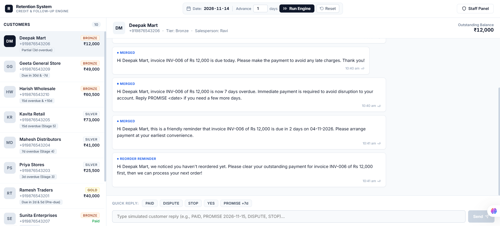
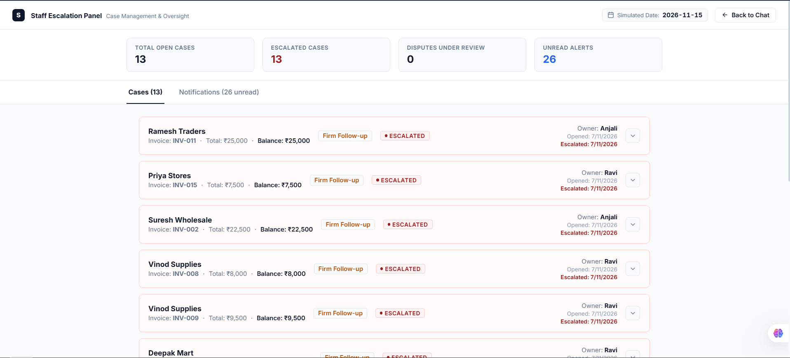
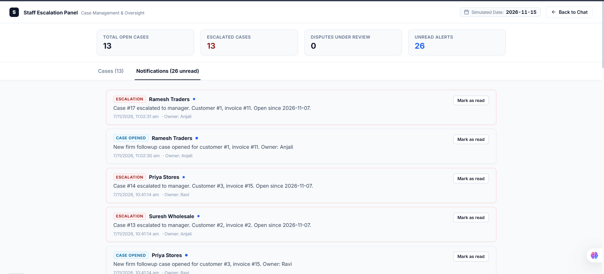

# DEMO.md — System Walkthrough & Visual Proof

> Step-by-step walkthrough for the reviewer. All 6 scenarios can be tested in under 5 minutes from the browser.

---

## Visual Demonstration

### 1. Mock WhatsApp Chat UI & Payment Follow-Up Engine



*The customer communication portal showing the customer directory with lifecycle status tags, simulated date console (`2026-11-14`), quick reply chips (`PAID`, `DISPUTE`, `STOP`, `YES`, `PROMISE +7d`), and automated follow-up messages showing remaining balance (`INV-006` showing ₹12,000 balance after partial payment).*

---

### 2. Staff Escalation Panel — Active Cases & Escalation Status



*Internal staff dashboard at `/staff` showing real-time KPI metrics (`13 Open Cases`, `13 Escalated Cases`, `26 Unread Alerts`), assigned salesperson case owners (`Anjali`, `Ravi`), and manager escalation tags (`• ESCALATED`).*

---

### 3. Real-Time Staff Alerts & Escalation Notifications



*Notification stream alerting salespeople and managers when cases escalate past 2 simulated days, invoices reach firm follow-up, or customers register disputes, with one-click "Mark as read" functionality.*

---

## Step 1: Start the System

```bash
docker compose up -d
cd backend && npm install && npm run migrate && npm run seed && npm run dev
# In a new terminal:
cd frontend && npm install && npm run dev
```

Open **http://localhost:3000** in your browser.

---

## Step 2: Key UI Controls

- **Top Navigation Bar**:
  - **Simulated Date**: Displays current fake date in PostgreSQL.
  - **Advance Clock**: Enter $N$ days and click **Run Engine** to move time forward and execute the stage engine.
  - **Reset**: Instant baseline reset. Restores the database and clock to today (`2026-11-07`) with fresh seed data.
  - **Staff Panel**: Direct link to the internal staff dashboard at `http://localhost:3000/staff`.
- **Customer Directory**: Displays all 10 customers with tier badges (`GOLD`, `SILVER`, `BRONZE`), outstanding balances, and their lifecycle scenario tag.
- **Quick Action Chips**: One-click replies (`PAID`, `DISPUTE`, `STOP`, `YES`, `PROMISE +7d`) for instant customer reply simulation.

---

## Step 3: Verifying the Six Required Scenarios

### Scenario 1: Customer pays before due date — no follow-up sent
1. Select **Sunita Enterprises** (c7 — `INV-007` is fully paid, ₹12,000 paid).
2. Advance clock by 10 days (**Run Engine**).
3. **Result**: **No stage messages appear in chat**. The stage engine skips fully-paid invoices.

---

### Scenario 2: Partial payment shows reduced balance
1. Select **Deepak Mart** (c6 — `INV-006`: ₹20,000 amount, ₹8,000 paid = ₹12,000 balance).
2. Advance clock by 1 day.
3. **Result**: The reminder message explicitly shows **₹12,000** (remaining balance), not ₹20,000 (original invoice total).

---

### Scenario 3: PROMISE reply pauses reminders
1. Select **Priya Stores** (c3 — `INV-003` is 3 days overdue).
2. Advance clock by 1 day → `soft_followup` reminder fires.
3. In the chat, click the **`PROMISE +7d`** quick button and hit **Send**.
4. The bot replies: *"Thank you! We have noted your promise to pay by [date]. Reminders are paused until then."*
5. Advance clock by 5 days → **No messages sent** (reminders paused).
6. Advance clock past the promised date → Reminders resume at the next stage.

---

### Scenario 4: DISPUTE reply pauses collections
1. Select **Mahesh Distributors** (c4 — `INV-004` is 7 days overdue).
2. Advance clock by 1 day → `firm_followup` message fires and a case is opened.
3. Click the **`DISPUTE`** quick button and hit **Send**.
4. Switch to the **Staff Panel** (`http://localhost:3000/staff`) → Dispute case is visible with status `open`.
5. Return to chat and advance clock 10 more days → **No final notice sent** (collections strictly paused).

---

### Scenario 5: STOP reply halts all messages
1. Select **Kavita Retail** (c5).
2. Click the **`STOP`** quick button and hit **Send**.
3. An **`Opted Out`** indicator appears next to Kavita Retail in the customer list.
4. Advance the clock by 20 days → **Zero messages** sent to this customer.
5. In the **Staff Panel Notifications Tab**, an alert is logged for salesperson *Anjali*.

---

### Scenario 6: 3 overdue invoices merged into 1 message
1. Select **Vinod Supplies** (c8 — has `INV-008`, `INV-009`, and `INV-010` all overdue).
2. Advance clock by 1 day.
3. **Result**: Customer receives **exactly 1 message** (not 3), itemizing all 3 overdue invoices with a consolidated total.

---

## Step 4: Run the Automated Test Suite

To run all 16 automated tests covering both test suites against the isolated test database:

```bash
cd backend
npm test
```

Expected output:
```text
PASS tests/engine.test.js
  ✓ E1: stage fires exactly once per invoice (idempotency)
  ✓ E2: pre_due stage fires when clock is 2 days before due date
  ✓ E3: due_date stage fires when clock matches due date
  ✓ E4: soft_followup fires at day +3
  ✓ E5: firm_followup fires at day +7 and opens a case
  ✓ E6: final_notice fires at day +15 and escalates case
  ✓ E7: multi-invoice customer receives one merged message
  ✓ E8: paid invoice generates no messages
  ✓ E9: opt_out customer receives no messages
  ✓ E10: case auto-escalates after 2 simulated days

PASS tests/scenarios.test.js
  ✓ Scenario 1: Customer pays before due date
  ✓ Scenario 2: Partial payment shows reduced balance
  ✓ Scenario 3: Customer replies PROMISE with date
  ✓ Scenario 4: Customer replies DISPUTE
  ✓ Scenario 5: Customer replies STOP
  ✓ Scenario 6: Customer has 3 overdue invoices

Test Suites: 2 passed, 2 total
Tests:       16 passed, 16 total
```

---

## Step 5: Resetting Baseline

You can reset the entire system to Day 0 at any time:
- **Option A**: Click the **"Reset"** button in the top navigation bar of the UI.
- **Option B**: Via API endpoint:
  ```bash
  curl -X POST http://localhost:4000/seed/reset
  ```

---

## Key Architectural Decisions

1. **Idempotency**: `invoice_stages` has a unique constraint on `(invoice_id, stage_name)` with `ON CONFLICT DO NOTHING`. Running the stage engine twice on the same day is completely safe.
2. **Config-Driven**: Stage timing and copy live in `stages.json`; discount rules live in `offers.json`.
3. **Pluggable Messaging**: `MockProvider` and `CloudApiProvider` share the identical `MessageProvider` interface.
4. **No Cron / Redis Dependency**: Driven deterministically by the simulated clock endpoint (`POST /clock/advance`).
5. **Clean Date Types**: PostgreSQL date types are parsed as pure calendar strings (`YYYY-MM-DD`), avoiding timezone shifting.
